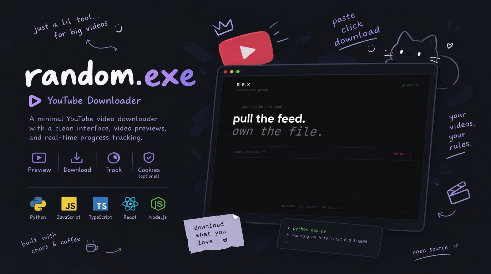

 <p align="center">
  
</p>

<div align="center">

# random.exe

**pull the feed. own the file.**

A minimal, self-hosted YouTube downloader built for people who like things simple.

[Features](#-features) · [Installation](#-installation) · [Cookies Setup](#-how-to-get-your-own-cookiestxt) · [Security](#-security)


</div>

---

## 🖤 About

`random.exe` is a self-hosted YouTube video downloader powered by Python, Flask, and vanilla JavaScript.

Paste a YouTube URL, fetch the video's information, and download it through a minimal interface designed around one idea: **less clutter, more control.**

No complicated setup interface. No unnecessary distractions. Just a small project built to do its job.

## ✨ Features

- 🎬 **Video previews** — retrieve available video information, including titles and thumbnails.
- ⬇️ **Video downloads** — download supported videos through the web interface.
- 📊 **Progress tracking** — monitor download progress.
- 🔗 **YouTube URLs** — supports common YouTube URL formats, including Shorts and shortened links, subject to availability.
- 🍪 **Optional cookies** — use your own local cookies when authentication is required.
- 🖥️ **Self-hosted** — run the application on your own machine.
- 🌑 **Minimal UI** — dark visuals, subtle scanlines, and red accent details.

## 🧰 Requirements

Before running the application, install:

- [Python](https://www.python.org/downloads/)
- [Git](https://git-scm.com/downloads/) — optional, for cloning the repository
- [FFmpeg](https://ffmpeg.org/download.html) — recommended for merging separate audio and video streams
- A browser such as Chrome or Edge — only if you need to export cookies

A `cookies.txt` file is optional and should only be used when needed.

## 🚀 Installation

### 1. Clone the repository

Replace the placeholders with your actual GitHub repository URL and folder name.

```bash
git clone YOUR_REPOSITORY_URL
cd YOUR_REPOSITORY_NAME
```

Alternatively, download the repository as a ZIP and extract it.

### 2. Create a virtual environment

```bash
python -m venv .venv
```

Activate it.

**Windows — PowerShell:**

```powershell
.venv\Scripts\Activate.ps1
```

**Windows — Command Prompt:**

```bat
.venv\Scripts\activate.bat
```

**Linux / macOS:**

```bash
source .venv/bin/activate
```

### 3. Install dependencies

```bash
python -m pip install flask yt-dlp
```

If the project includes a `requirements.txt`, use this instead:

```bash
python -m pip install -r requirements.txt
```

### 4. Start the application

Run the Flask application from the project directory:

```bash
python app.py
```

Open your browser and visit:

```text
http://127.0.0.1:5000
```

Keep the terminal open while using the application.

## 🍪 How to Get Your Own `cookies.txt`

Some videos may require an authenticated browser session. If you encounter access errors, you can export your own cookies for local use.

**Cookies are sensitive. Never share your exported file with anyone or commit it to GitHub.**

### Step 1 — Install the extension

Find **Get cookies.txt LOCALLY** in the official [Chrome Web Store](https://chromewebstore.google.com/).

Check the publisher, permissions, and extension details before installing it. Do not install unofficial copies from random websites.

### Step 2 — Open YouTube

1. Open [YouTube](https://www.youtube.com/).
2. Sign in only if authentication is needed.
3. Make sure you're using the browser where the extension is installed.

### Step 3 — Export your cookies

1. Open YouTube in your browser.
2. Click the extension icon in the toolbar, or find it in the extensions menu.
3. Follow the extension's instructions to export cookies for the current site.
4. Save the exported file as `cookies.txt`.

The exact steps may vary depending on the extension version.

### Step 4 — Place the file locally

Put `cookies.txt` in the directory expected by the application.

Example:

```text
random.exe/
├── app.py
├── app.js
├── style.css
├── templates/
│   └── index.html
├── cookies.txt       # Private — never upload
├── banner.png
├── README.md
└── .gitignore
```

The application uses the cookie file if it exists at the configured path. If YouTube still rejects a request, the cookies may have expired or the video may have other restrictions.

**You do not need cookies for every video.** Try without them first.

## 🔐 Security

Your account matters more than getting a download to work.

### Never publish your cookies

A `cookies.txt` file may contain session credentials that could allow someone to access your Google or YouTube account.

Create a `.gitignore` file in your repository root and add:

```gitignore
# Sensitive authentication cookies
cookies.txt
*.cookies.txt

# Python
__pycache__/
*.py[cod]
.venv/
venv/

# Local environment secrets
.env
.env.*
!.env.example
```

This prevents matching untracked files from being added to Git accidentally.

### If the file was already committed

Adding it to `.gitignore` does not remove it from Git's tracking. If you have already committed it, run:

```bash
git rm --cached cookies.txt
git add .gitignore
git commit -m "Remove cookies from tracking"
```

This does **not** remove the file from previous commits.

If real cookies were published, treat them as compromised. Review your [Google Account Security](https://myaccount.google.com/security), revoke affected sessions where possible, and clean the repository history before republishing.

### Hosting the application

If you deploy `random.exe` to a public server:

- Do not include your personal `cookies.txt`.
- Do not let visitors access server files or download arbitrary server paths.
- Do not expose authentication cookies through logs, error messages, or API responses.
- Apply request limits and protect the download endpoints from abuse.
- Remember that anyone who can access the public site may be able to use its backend.

For a public deployment, avoid using your personal authenticated session to serve requests for strangers.

## 🗂️ Project Structure

| File | Description |
|---|---|
| `app.py` | Python Flask backend and download logic |
| `app.js` | Frontend JavaScript |
| `style.css` | Application styling |
| `templates/index.html` | HTML template rendered by Flask |
| `banner.png` | Repository banner |
| `README.md` | Project documentation |
| `.gitignore` | Excludes sensitive and unnecessary files |
| `cookies.txt` | Optional private local cookies; never publish |

## 🛠️ Troubleshooting

<details>
<summary><strong>Video information cannot be fetched</strong></summary>

- Check that the URL is valid.
- Update `yt-dlp`:

  ```bash
  python -m pip install -U yt-dlp
  ```

- The video may be private, unavailable, age-restricted, or otherwise inaccessible.

</details>

<details>
<summary><strong>Download fails or audio is missing</strong></summary>

- Install FFmpeg and ensure it is available in your system's PATH.
- Check the terminal for error messages.
- Update `yt-dlp` and try again.

</details>

<details>
<summary><strong>The cookies file is not detected</strong></summary>

- Check that the filename is exactly `cookies.txt`.
- Confirm that it is in the configured location.
- Verify that the file is ignored by Git.
- Never upload your cookies to fix a local configuration issue.

</details>

<details>
<summary><strong>The application does not start</strong></summary>

- Check that Python is installed.
- Activate your virtual environment.
- Install the dependencies.
- Make sure the port used by Flask is available.

</details>

## ⚠️ Disclaimer

This project is intended for personal use and educational purposes.

Only download content you have permission to download. Respect copyright, applicable laws, and YouTube's terms of service.

This project is independent and is not affiliated with, endorsed by, or sponsored by YouTube or Google.

## 🖤 Credits

Built with Python, Flask, JavaScript, CSS, and a little bit of chaos.

**random.exe — pull the feed. own the file.**

